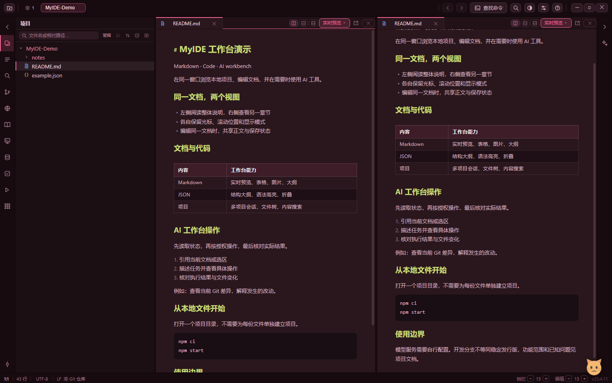

# MyIDE — AI 文档与代码工作台

**AI-assisted Markdown and code workspace for Windows.**

MyIDE 是面向本地文件与多项目工作的 Windows 桌面应用，集成 Markdown 实时预览、代码编辑、Git、内置浏览器和 AI 工作台操作接口。基于 Electron、原生 JavaScript 和 CodeMirror 6。

[English](README.en.md) · [快速开始](docs/getting-started.md) · [功能与限制](docs/features.md) · [AI 接口](docs/ai-api.md) · [文档导航](docs/README.md) · [问题反馈](https://github.com/lijieyu233/my_ide/issues)

*真实应用的隔离演示项目，两栏显示同一文档的不同位置，不包含用户文档。*

## 适合用来做什么？

| 用途 | 已实现能力 |
| --- | --- |
| 编辑 Markdown 笔记与项目文档 | 实时预览、源码、只读预览、源码对照、章节大纲、表格编辑、图片复制与尺寸调整 |
| 同时阅读或编辑两份内容 | 左右或上下分屏；同一文档双视图共享正文，各自切换文档、定位与滚动 |
| 浏览代码与 JSON | 语法高亮、查找替换、JSON 结构大纲与折叠、文件编码选择、项目内容搜索 |
| 管理本地项目 | 多项目会话、文件树、Git 状态/差异/历史/提交与同步、程序启动面板 |
| 在工作台内使用 AI | 引用文档与选区，通过已有工具操作编辑器、浏览器、Git、任务、启动面板等模块 |
| 查看网页与阅读资料 | 内置浏览器标签/收藏/标签组、选区翻译；TXT、基础重排 EPUB、CBZ 阅读与书架 |

完整范围与限制见[功能说明](docs/features.md)。AI 功能需要配置模型服务；DSH 模式另有运行环境要求。本地文件编辑不要求配置 AI。

## 快速开始

当前公开源码版本标识为 **0.8.5**，**dev** 是持续开发分支，尚不代表稳定发行版。项目主要在 Windows 上开发和验证。

准备 Git、Node.js 24 与 npm，然后运行：

~~~powershell
git clone --branch dev https://github.com/lijieyu233/my_ide.git
cd my_ide
npm ci
npm start
~~~

首次启动后打开本地项目目录。未配置 AI 时也能编辑本地文件。依赖安装和 Electron 二进制下载需要网络。

- [安装、首次使用与常见问题](docs/getting-started.md)
- [Releases](https://github.com/lijieyu233/my_ide/releases)：正式安装包以已发布的 Release 附件为准。当前未提供正式 Latest Release；源码包不等于可直接运行的 EXE。
- 本地打包：运行 npm run build，便携版输出到 dist/。本地构建产物不自动成为公开发布版本。

## AI 可以操作哪些功能？

MyIDE 的 AI 助手可以读取工作台状态，并在授权范围内调用模块工具。例如：

- “把当前文档向右拆分，在另一栏打开项目说明。”
- “读取当前 JSON 的结构大纲，定位到 audio。”
- “打开启动面板，查看这个程序的状态和日志。”
- “查看当前 Git 差异，说明哪些文件发生了变化。”

这些是自然语言使用示例，执行结果取决于模型、当前文档、配置和授权。工具沿用状态快照、项目/会话归属与权限检查，不能把请求受理当成操作成功。

接口面向应用内助手，**目前不是独立的公共 HTTP API 或 MCP 服务**。工具名称、示例和边界见 [AI 工作台接口指南](docs/ai-api.md)，逐项接入状态见 [AI 操作接口模块清单](docs/开发文档-171-AI操作接口模块清单.md)。

## 常用快捷键

| 快捷键 | 操作 |
| --- | --- |
| Ctrl+O / Ctrl+P | 打开项目 / 快速打开文件 |
| Ctrl+Shift+F | 项目内容搜索 |
| Ctrl+F / Ctrl+H | 文档查找 / 替换 |
| Ctrl+S / Ctrl+W | 保存 / 关闭当前标签 |
| Ctrl+K / Alt+9 | Git 提交面板 / Git 历史 |
| Ctrl+Alt+S | 设置与快捷键配置 |

快捷键可在设置中修改；分屏还可以通过标签右键或标签栏按钮操作。

## 项目状态与使用边界

- 这是持续开发中的工作台。专项验证结果不等于所有测试或全部模块均通过；历史失败与验收范围保留在专项文档中。
- Git 的部分能力依赖系统 Git；JS 回落能力与原生 Git 并不完全一致。
- EPUB 支持基础重排内容，CBZ 用于图片页阅读。未承诺 PDF 转换、漫画 OCR、DRM 内容或所有电子书格式。
- 文件主要保留在本地；配置远程 AI、翻译或 SSH 服务后，相关内容会按操作发送至对应服务，并不代表全部功能离线运行。
- 仓库当前尚未声明开源许可证；公开可见不表示已授予任意使用、修改或再分发许可。许可证确定后会在此处更新。

## 文档与贡献

- [文档导航 / Documentation](docs/README.md)：用户指南、AI 接口、开发与验收记录。
- [开发与发布流程](docs/development.md)：运行检查、分支职责、发布条件和截图更新方法。
- [改进进度总览](docs/改进进度总览.md)、[路线图](ROADMAP.md)：已做、待做和历史记录。
- [插件开发](plugins/README.md)：扩展文件格式渲染。

反馈问题时请提供系统、版本/提交号、复现步骤、实际结果和必要的脱敏截图。开发协作遵循 [AGENTS.md](AGENTS.md)，产品设计历史见[开发大纲](开发大纲.md)。
