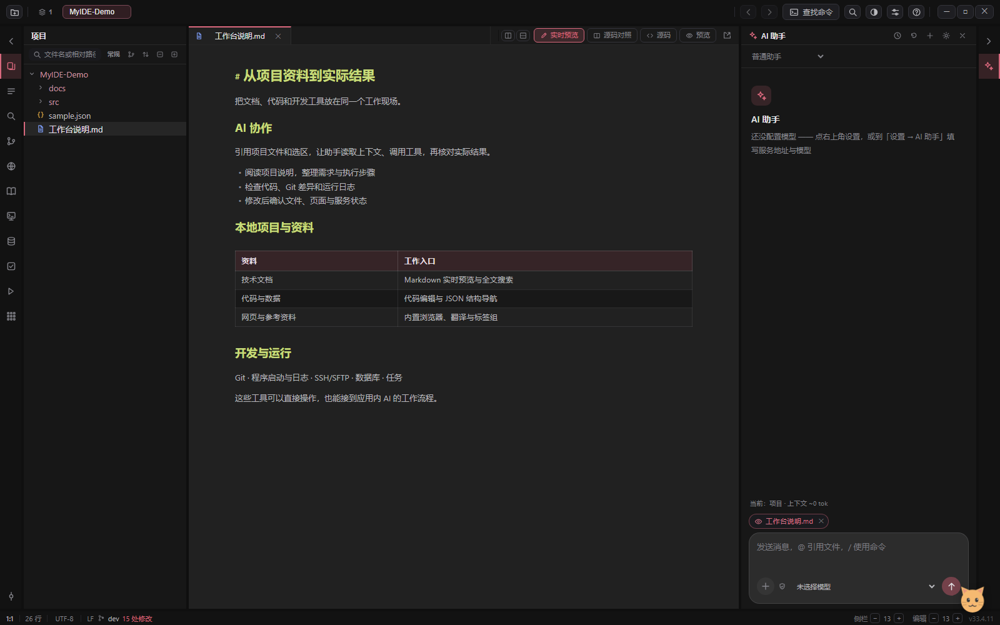

# MyIDE — AI 驱动的本地工作台

**把项目文档、代码、网页和开发工具放在同一个工作现场，让 AI 带着上下文协助完成工作。**

MyIDE 是面向 Windows 的开源桌面应用。你可以用它整理技术资料、维护代码项目、检查服务和处理日常开发任务。AI 助手能读取当前工作状态，在授权范围内操作应用中的工具；你也可以直接使用每个模块。

[English](README.en.md) · [下载与启动](docs/getting-started.md) · [使用场景](docs/workflows.md) · [完整能力](docs/features.md) · [文档](docs/README.md)

*真实应用的隔离演示项目，使用虚构资料；不展示伪造的 AI 执行结果。*

## 为什么做 MyIDE

一项工作常常要同时打开笔记、代码、浏览器、终端、Git 和数据库。文件散在不同窗口，交给 AI 时又需要重新解释项目、粘贴内容、转述执行结果。

MyIDE 把这些工作入口与 AI 连接起来：从本地项目出发，查资料、编辑内容、执行工具，再回到实际文件和运行结果核对。文件保留在原有目录中，可以继续由其他编辑器和 Git 管理。

## 三条核心工作流

### 1. 带着项目上下文使用 AI

引用文件、当前选区和工作台状态，让助手阅读资料、整理文档、分析代码或排查问题。普通助手对接 OpenAI 兼容模型服务，也可连接本机 DeepSeek Harness（DSH）。

已接入的 AI 工具覆盖项目文件、编辑器、大纲、浏览器、Git、任务、启动面板、SSH/SFTP、数据库和设置。操作前读取状态，涉及修改或执行时沿用权限检查，操作后核对实际结果。跨项目后台运行的 DSH 任务仍归属原项目与会话。

[AI 使用指南](docs/ai-guide.md) · [工具接口与范围](docs/ai-api.md)

### 2. 管理本地文档与项目知识

以文件目录组织项目，搜索和编辑 Markdown、代码与 JSON，在同一工作台查看 HTML、图片、PDF 和常见 Office 文件。Markdown 提供实时预览和章节大纲，JSON 提供结构导航；多项目会话保存各自的工作现场。

浏览器用于查阅网页、保存标签组和选区翻译；书架管理 TXT、基础 EPUB 和 CBZ 的阅读进度。编辑器分屏、表格和图片操作属于日常编辑工具，具体步骤放在[功能指南](docs/features.md)。

### 3. 把开发与排查接到实际工具

查看 Git 状态、历史与差异，提交和同步代码；从启动面板管理项目程序、端口、就绪检查与日志；通过 SSH/SFTP 管理远程文件和终端，使用数据库面板查询数据，用任务面板跟踪工作。

这些模块有直接操作入口，也向应用内 AI 提供相应工具。连接远端、启动程序或写入数据时，需要自己的环境配置和授权。

[从需求到验证的完整示例](docs/workflows.md) · [能力与边界](docs/features.md)

## 开始使用

源码运行需要 Windows、Git 和 Node.js 24：

~~~powershell
git clone --branch dev https://github.com/lijieyu233/my_ide.git
cd my_ide
npm ci
npm start
~~~

- [下载与首次使用](docs/getting-started.md)：Windows 便携包、源码运行、配置入口。
- [GitHub Releases](https://github.com/lijieyu233/my_ide/releases)：以附件和版本说明为准；预发布版会明确标识。
- 本地编辑无需配置 AI。模型、翻译、SSH 和数据库连接按需配置。

## 当前定位

MyIDE 基于 Electron、JavaScript 和 CodeMirror 6，当前持续在 dev 分支开发，主要验证 Windows。它侧重文档与项目工作流，尚未提供完整 IDE 的语言服务、调试器和扩展生态。

AI 工具供应用内助手调用，目前未发布独立公共 HTTP API 或 MCP 服务。远程模型、翻译与服务器操作会按请求发送相关内容；本地文件存储不代表所有功能离线。版本的验证范围和已知问题见 [发布说明](CHANGELOG.md)。

## 参与项目

[用户文档](docs/README.md) · [反馈问题](https://github.com/lijieyu233/my_ide/issues) · [贡献指南](CONTRIBUTING.md) · [架构与扩展](docs/architecture.md)

项目代码采用 [MIT License](LICENSE)。第三方依赖及随包资源遵循各自许可证。
